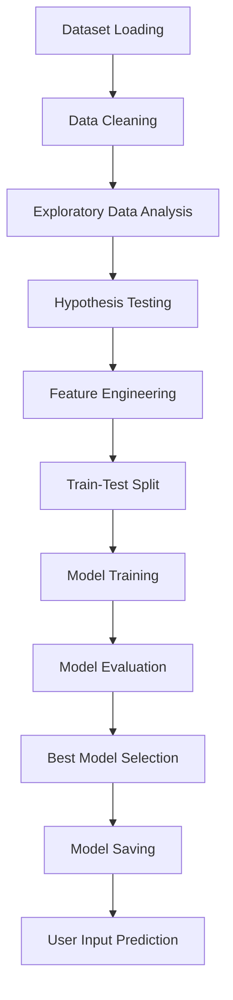

# 📈 Yes Bank Stock Price Prediction


## 📌 Project Overview

This Machine Learning project analyzes historical Yes Bank stock prices and estimates monthly closing prices using regression algorithms.

The project includes data preprocessing, exploratory data analysis, hypothesis testing, feature engineering, model training, performance evaluation and model saving.

## 🎯 Project Objectives

- Analyze historical stock price trends.
- Understand relationships between stock price variables.
- Implement five Machine Learning regression models.
- Compare model performance using evaluation metrics.
- Identify and save the best-performing model.
- Develop a user-input closing price estimation system.

## 📊 Dataset Information

| Parameter | Details |
|---|---|
| Company | Yes Bank |
| Total Records | 185 |
| Total Columns | 5 |
| Duration | July 2005 – November 2020 |
| Training Records | 148 |
| Testing Records | 37 |
| Missing Values | 0 |
| Duplicate Records | 0 |

### Dataset Features

- **Date:** Monthly observation date
- **Open:** Opening stock price
- **High:** Highest stock price
- **Low:** Lowest stock price
- **Close:** Closing stock price (Target variable)

## 🚀 Key Features

- Data cleaning and preprocessing
- 20 exploratory data visualizations
- Statistical hypothesis testing
- Feature engineering and selection
- Chronological 80:20 train-test split
- Five regression algorithms
- Model performance comparison
- Model saving and loading using Joblib
- User-input prediction system

## 🛠️ Technologies Used

- Python
- Pandas
- NumPy
- Matplotlib
- Seaborn
- SciPy
- Scikit-learn
- Joblib
- Google Colab

## ⚙️ Project Workflow



## 🤖 Machine Learning Models

1. Linear Regression
2. Ridge Regression
3. Lasso Regression
4. Decision Tree Regression
5. Random Forest Regression

## 📉 Model Performance

| Model | MAE | MSE | RMSE | R² Score |
|---|---:|---:|---:|---:|
| **Linear Regression** | **9.7843** | **250.3307** | **15.8218** | **0.9848** |
| Ridge Regression | 12.6357 | 375.7794 | 19.3850 | 0.9771 |
| Lasso Regression | 13.4478 | 423.5335 | 20.5799 | 0.9742 |
| Decision Tree | 14.7453 | 435.8148 | 20.8762 | 0.9735 |
| Random Forest | 13.8524 | 439.4116 | 20.9621 | 0.9732 |

## 🏆 Best Performing Model

### Linear Regression

- **R² Score:** 0.984754
- **MAE:** 9.7843
- **MSE:** 250.3307
- **RMSE:** 15.8218

Linear Regression achieved the lowest prediction errors and highest R² score among the five models on the current testing dataset.

The model explains approximately 98.48% of the variation in the test-set closing prices.

## 💻 Sample Prediction

```text
Enter Opening Price: 100
Enter Highest Price: 120
Enter Lowest Price: 90

Estimated Closing Price: Rs. 109.10
```

## 📂 Project Structure

```text
Yes-Bank-Stock-Price-Prediction/
│
├── Yes_Bank_Stock_Price_Prediction.ipynb
├── data_YesBank_StockPrices.csv
├── yes_bank_model.pkl
├── Yes_Bank_Insights.pptx
└── README.md
```

## 🔧 How to Run the Project

### Step 1: Clone the repository

```bash
git clone https://github.com/nithin00733/Yes-Bank-Stock-Price-Prediction.git
```

### Step 2: Install required libraries

```bash
pip install pandas numpy matplotlib seaborn scipy scikit-learn==1.8.0 joblib
```

### Step 3: Open the notebook

Open `Yes_Bank_Stock_Price_Prediction.ipynb` using Google Colab or Jupyter Notebook.

### Step 4: Upload the dataset

Upload `data_YesBank_StockPrices.csv` into the Colab runtime or place it in the local project directory.

### Step 5: Execute the notebook

Run all cells in sequence and enter sample values in the prediction system.

## 🔄 Reuse the Trained Model

```python
import joblib
import pandas as pd

model = joblib.load("yes_bank_model.pkl")

input_data = pd.DataFrame({
    "Open": [100],
    "High": [120],
    "Low": [90]
})

prediction = model.predict(input_data)

print(f"Estimated Closing Price: Rs. {prediction[0]:.2f}")
```

Only load model files from trusted sources.

## 💡 Key Insights

- Yes Bank stock prices experienced significant changes over time.
- Open, High and Low have strong positive correlations with Close.
- Low price has the strongest correlation with the closing price.
- Linear Regression performed better than the other implemented models on the current test set.

## ⚠️ Project Limitations

- The dataset contains historical monthly stock prices.
- The model requires same-month Open, High and Low prices.
- The model estimates closing prices rather than forecasting future stock prices.
- Hyperparameter tuning and cross-validation have not been performed.
- Independent validation is required to confirm model performance.

## 🔮 Future Enhancements

- Time-series forecasting
- Hyperparameter optimization
- Time-series cross-validation
- Updated historical datasets
- Interactive web application using Streamlit

## 👨‍💻 Developer

**Nithin R**

B.E. Computer Science and Engineering  
Specialization in Artificial Intelligence  
Sathyabama Institute of Science and Technology

- GitHub: [nithin00733](https://github.com/nithin00733)
- Portfolio: [Visit Portfolio](https://nithin00733.github.io)

## 📢 Disclaimer

This project is developed for educational and academic purposes only. It is not intended for financial or investment decisions.

---

⭐ If you find this project useful, consider starring this repository.
